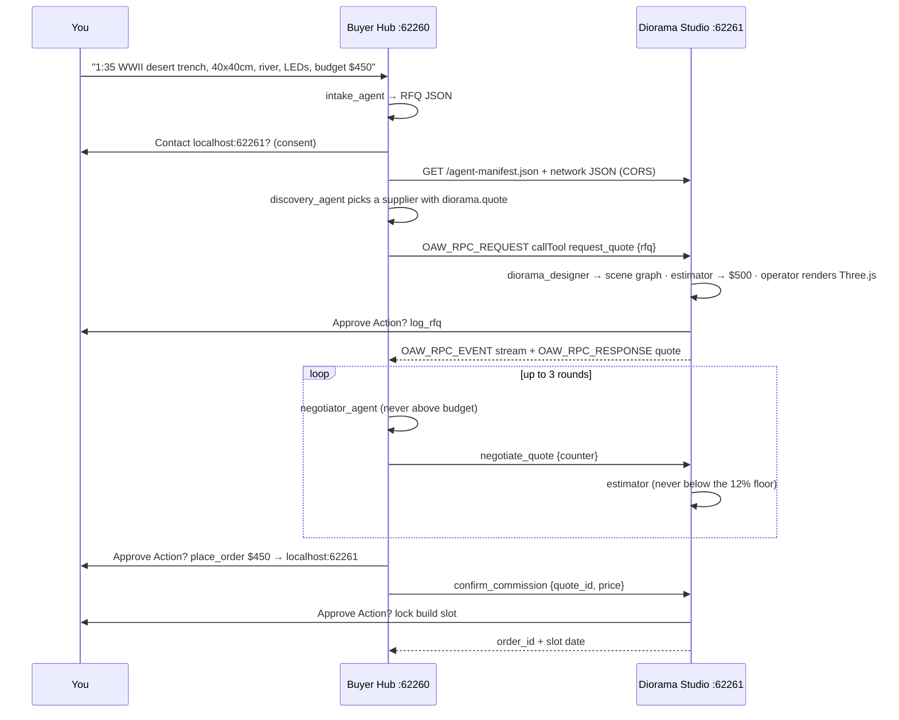

# Open Agentic Dioramas

Two independent, static agentic websites that find each other through their public `agent-manifest.json` and negotiate in the visitor's browser. There is no backend and there are no dependencies. Built for the [Cognizant Open Agentic Web Challenge](https://github.com/cognizant-ai-labs/agentic-web).

| Site | Role | Local | Live |
| --- | --- | --- | --- |
| **OpenAgentic Procurement & Commission Hub** (`buyer-hub/`) | Buyer agents: RFQ, supplier discovery, negotiation, approved order | http://localhost:62260 | https://isgudtek.github.io/open-agentic-dioramas/buyer-hub/ |
| **Miniature Worlds 3D Diorama Studio** (`diorama-studio/`) | Supplier agents: 3D blueprint, quote, counter-offers, commission board | http://localhost:62261 | https://isgudtek.github.io/open-agentic-dioramas/diorama-studio/ |

## Run locally

```bash
npm start          # node dev-server.js: both sites, CORS on, no install needed (Node 18+)
npm run verify     # HTTP conformance checks across both ports
```

Open http://localhost:62260, click the first example and press **Run commission**. The studio opens in split view. You approve four times:

1. On the hub, allow contact with the studio.
2. On the studio, log the RFQ.
3. On the hub, place the order.
4. On the studio, lock the build slot.

The demo brief quotes $500. The hub counters $430, the studio comes back with $465, and the hub's $450 is accepted.

## How it works



- **JSON is the source of truth.** Each site's network file (`procurement_hub.network.json`, `diorama_studio.network.json`) holds every agent's instructions and output schema. The runtime loads them from `agent-manifest.json`.
- **Models propose, code enforces.** The studio clamps every scene inside the base, applies the scale rules (1:12, 1:35, 1:64, 1:72 with size limits) and never prices below the 12% floor. The hub never accepts or orders above the budget. When a model's proposal breaks a rule, the stream shows the policy line.
- **Human in the loop.** Every write tool pauses on an **Approve Action?** card that shows the exact JSON payload, the price and the target origin. Writes requested by another site are approved on the site that owns them.
- **Cross-site protocol.** `window.postMessage` with `OAW_RPC_REQUEST` / `OAW_RPC_RESPONSE`, plus `OAW_RPC_EVENT` so the hub shows the studio's agent handoffs live. Origins are checked on both sides. Unknown callers need consent.
- **Global API on both sites:** `window.OpenAgenticWeb = { manifest, run(prompt), callTool(name, args), getState() }`.
- **Each site uses its own model settings.** Your Otari key stays on the origin where you entered it. The supplier never receives it.

## Model settings (both sites)

| Mode | What runs |
| --- | --- |
| **Mozilla Otari Gateway (BYOK)** | `POST {base}/chat/completions` with `Authorization: Bearer <key>` and `response_format: json_object`. Base `https://api.otari.ai/api/v1`, or one click for EU `https://eu.api.otari.ai/api/v1`. **Load my models** lists what your key can use (`GET /models`). If the key is in the other region (421), the error offers a one-click switch. |
| **Gemini Nano (Local On-Device)** | Chrome Prompt API (`window.LanguageModel`, falling back to `window.ai.languageModel`) with `responseConstraint`. If a Chrome build rejects the constraint, it retries with JSON instructions. If Nano is unavailable, it runs **Gemini Nano (Local Sim)**: scripted answers with simulated latency, labeled *simulated* in every trace. |
| **Hybrid Auto** | Nano first. If Nano is unavailable, fails or gives no answer within 25 s, Otari answers. |
| **Demo Mode** | Deterministic agents, no network, no key. The default when Nano isn't available. |

The execution stream tags every model call with its source, for example `[otari • anthropic/claude-haiku-4-5 • 812ms • 640 tok]`, `[nano-local • 410ms • $0.00]` or `[nano-sim • 300ms • simulated • $0.00]`.

## Deploy

```bash
npm run build:pages    # writes docs/ for GitHub Pages (this repo publishes main/docs)
npm run verify:pages   # checks the live sites
npm run build -- --base https://your.host/path/ --out dist   # any other static host
```

The build copies `shared/` into each site, rewrites the localhost URLs in the manifests for the target base, adds `.well-known/agent-manifest.json`, and adds `.nojekyll`. On GitHub Pages both sites share the `isgudtek.github.io` origin. The postMessage protocol is the same, but for a true cross-origin demo run them locally on two ports or host them on two domains.

## Files

```
dev-server.js                 zero-dependency static server for both ports (CORS *, /shared mount, .well-known alias)
shared/oaw-core.js            providers, agent runtime, approvals, manifest validator, postMessage RPC
shared/oaw-ui.{js,css}        settings modal + status pill, execution stream, approval/consent modals, Manifest Inspector
buyer-hub/                    agent-manifest.json, procurement_hub.network.json, hub-logic.js, app.js, index.html, hub.css
diorama-studio/               agent-manifest.json, diorama_studio.network.json, studio-logic.js, scene.js (Three.js r187), app.js
scripts/build-sites.mjs       static build for any base URL
scripts/verify.mjs            HTTP conformance checks
docs/                         built GitHub Pages output
```

## Devpost submission note

> **Open Agentic Dioramas** is two independent agentic websites that do business with each other in the browser. A buyer types a commission into the **Procurement Hub**. Its `intake_agent` writes an RFQ. Its `discovery_agent` reads suppliers' public `agent-manifest.json` files and picks one that publishes `diorama.quote`. Its `negotiator_agent` then sends the RFQ to the **Miniature Worlds** studio over a postMessage RPC protocol. The studio's agents design a procedural 3D diorama, rendered live in Three.js, and price it from materials and labour hours. The two sides then negotiate: the studio never goes below its 12% floor, and the buyer never goes above budget. Each site owns its own writes, and every write stops on an **Approve Action?** card showing the exact payload, price and target origin.
>
> **Mozilla Otari** is a first-class provider. Visitors bring their own Otari key (global or EU region), load the models their organization can run, and every agent call goes through Otari's OpenAI-compatible `chat/completions` with JSON mode. Usage tokens are shown per call. **Hybrid Auto** runs **Gemini Nano** on the device first and falls back to Otari only when Nano can't answer. **Demo Mode** lets judges try everything without a key. The sites have no backend and no build step, and the agent prompts and schemas are published as JSON.

## License

MIT
